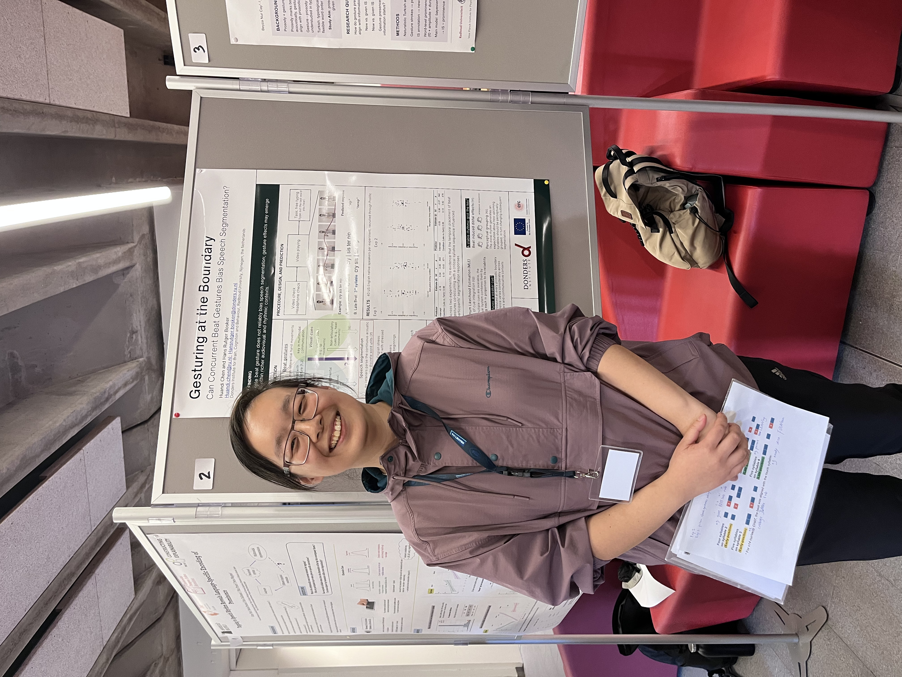

First experiences can be nervous but memorable, much like first-pass reading.

This September, I attended [23rd European Conference on Eye Movements (ECEM 2026)](https://www.uni-ulm.de/in/ecem2026/) in Ulm, Germany and [Symposium Series on Multimodal Communication (MMSYM 2026)](https://mmsym.org/) in Leuven, Belgium.

At the conferences, I gathered the courage to speak with researchers whose work I had read and cited. I am especially grateful to [Dr. Elizabeth Schotter](https://emac-usf.com/dr-schotter/) and [Dr. Linda Drijvers](https://lindadrijvers.nl/) for their kindness and encouragement during our conversations. Their openness made me feel welcome in the field and more confident about finding my own path as a researcher - **to be human and to be myself**!

If I am fortunate enough to become an established researcher like them one day, I hope I can also offer younger students the same patience, openness, and encouragement, and inspire the same enthusiasm for research that these scholars sparked in me.

  

    
    

      Talk at ECEM2026
    

  

  

    
    

      Poster presentation at MMSYM2026
    

  

