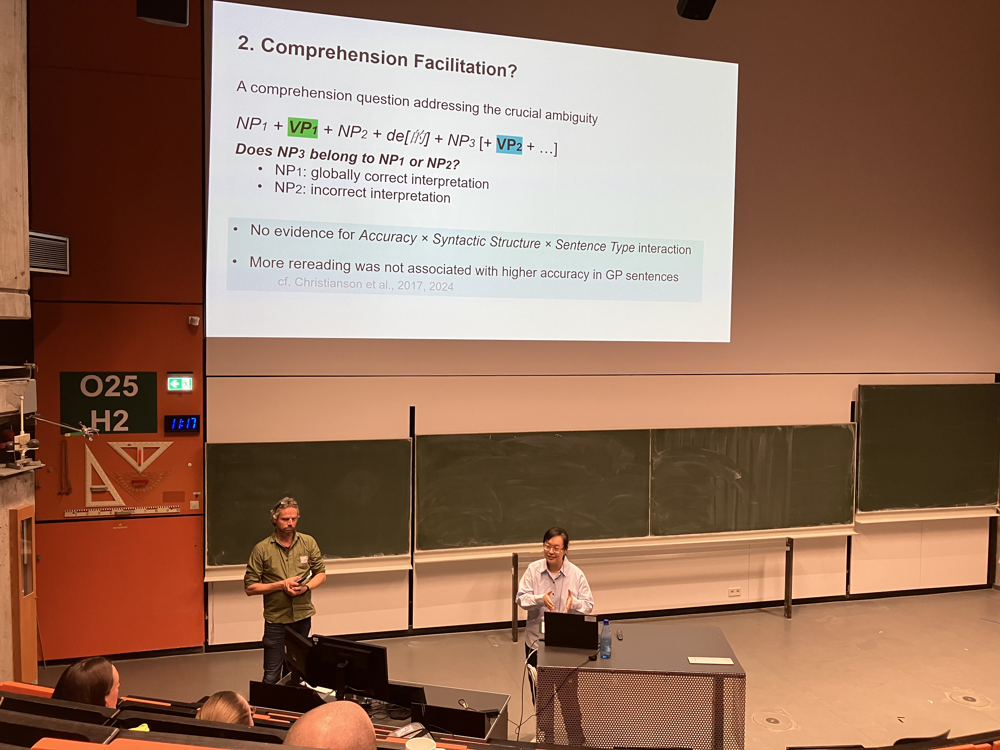

First experiences can be nervous but memorable, much like first-pass reading.

At my first two academic conferences, I gathered the courage to speak with researchers whose work I had read and cited. I am especially grateful to [Dr. Elizabeth Schotter](https://emac-usf.com/dr-schotter/) and [Dr. Linda Drijvers](https://lindadrijvers.nl/) for their kindness and encouragement during our conversations. Their openness made me feel welcome in the field and more confident about finding my own path as a researcher.

If I am fortunate enough to become an established researcher like them one day, I hope I can also offer younger students the same patience, openness, and encouragement, and inspire the same enthusiasm for research that these scholars sparked in me.

  <figure style="width: 48%; margin: 0; text-align: center;">
    
    <figcaption style="font-size: 0.9em; color: #666; margin-top: 8px;">
      Talk at ECEM2026
    </figcaption>
  </figure>

  <figure style="width: 40%; margin: 0; text-align: center;">
    
    <figcaption style="font-size: 0.9em; color: #666; margin-top: 8px;">
      Poster presentation at MMSYM2026
    </figcaption>
  </figure>

