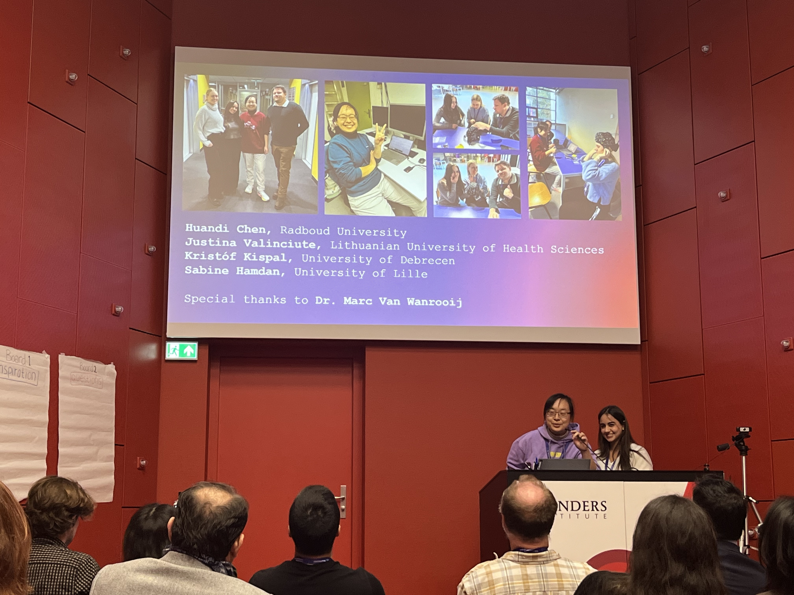

This was my first hackathon. In just three and a half days, our international team named *Spinning Dizzy* explored **how vestibular perturbation affects self-motion perception and how it might inform clinical vestibular assessment**. We had the opportunity to investigate this question using a very cool vestibular chair combined with functional near-infrared spectroscopy (fNIRS).

<figure style="max-width: 70%; margin: 24px auto; text-align: center;">
  
  <figcaption style="font-size: 0.9em; color: #666; margin-top: 8px;">
    Group presentation in the NeurotechEU General Assembly (Nijmegen, the Netherlands)
  </figcaption>
</figure>

### Reflection

The experience was new and exciting. A hackathon offers space to experiment with ambitious ideas, learn unfamiliar techniques, and see what a new team can accomplish in a short time (teamwork!).

It also prompted me to reflect on **scientific integrity**. The fast pace creates valuable opportunities for learning, but leaves limited time to validate every step, including checking that the code works as intended. As I continue my academic journey, I hope to carry this curiosity forward alongside a **commitment to rigor**: questioning assumptions, checking what seems uncertain, and being transparent about limitations.

I am grateful that this first hackathon helped me clarify **the standards I want to uphold as a researcher**.
